---
tags:
  - Regulation
  - Lighting & ventilation 照明及通風
  - Fire damper 防火閘
  - Fire Services 消防處
  - Fire resisting construction 耐火結構
---

# Cap. 123J Building (Ventilating Systems) Regulations <small>《建築物（通風系統）規例》（第 123J 章）</small>

!!! info "Document info 文件資料"
    | | |
    |---|---|
    | **Type 類別** | Regulation 規例: Cap. 123J 《建築物（通風系統）規例》（第 123J 章） |
    | **Provisions 條文** | Regs. 1–7 第 1–7 條 |
    | **In force 生效** | 23 October 1964 |
    | **Official language 官方語言** | English and Chinese (equally authentic) 中英文本同等真確 |
    | **Source 原文** | [eLegislation Cap. 123J](https://www.elegislation.gov.hk/hk/cap123J) |
    | **Last checked 最後核對** | 2026-11-21 against the version on eLegislation (version date 13/05/2021) |

## At a glance 重點摘要 {#at-a-glance}

=== "English"

    - Applies to ventilating systems with **ducts passing through walls, floors or ceilings from one compartment to another** (reg. 3), except FEHD-scheduled premises; administered by the **Director of Fire Services**.
    - **Design** (reg. 4): moving parts fenced; parts accessible for inspection (fan spindle for tachometer, intakes and exhausts measurable); intakes not in fire-hazard or rubbish locations, with **≤ 12 mm** corrosion-resistant mesh; ducts **non-combustible**, cleanable throughout, and a **fusible-link fire damper** (operating at **69 °C**) where passing through a floor, wall or ceiling, with FRR matching that element; **one duct per building**; non-combustible filters (not steel wool); approved electrostatic filters. The Director may exempt (reg. 4(2)).
    - **Owners** keep systems safe and efficient and have dampers, filters and precipitators inspected by an **RSC (ventilation works)** at intervals **≤ 12 months** (reg. 5).
    - The RSC issues a **certificate within 14 days**, with a copy to the Director (reg. 5A). FSD officers may test systems (reg. 6). Pre-1964 systems comply only when altered or found hazardous (reg. 7).

=== "中文"

    - 適用於**風管穿過牆、樓板或天花由一個防火間隔通往另一個**的通風系統（第 3 條），食環署表列處所除外；由**消防處處長**執行。
    - **設計**（第 4 條）：活動部件須圍護；各部分可供檢查（風扇軸可裝轉速計、進氣口及排氣口可量度）；進氣口不得位於有火警危險或易積垃圾的地方，並裝 **≤ 12 毫米**防銹網；風管須**不燃**、全長可清潔，穿過樓板、牆或天花處裝以**易熔連桿操作的防火閘**（**69°C** 動作），耐火時間與該構件相同；**一條風管只服務一幢建築物**；過濾器不燃（鋼絲棉除外）；靜電過濾器須經批准；處長可豁免（第 4(2) 條）。
    - **擁有人**須保持系統安全有效，並由**註冊專門承建商（通風工程）**每隔 **≤ 12 個月**檢查防火閘、過濾器及聚塵器（第 5 條）。
    - 承建商須在 **14 天內**發出**證明書**並把副本送交處長（第 5A 條）；消防處人員可測試系統（第 6 條）；1964 年前的系統只在改動或被認為有火警危險時才須符合規定（第 7 條）。

## Workflow / timeline 流程及時間表 {#workflow-timeline}

<figure markdown>
  { width="420" loading=lazy }
  <figcaption>Annual inspection cycle for ventilating systems. 通風系統年檢周期。 Summary diagram prepared for this site; check the source text for exact wording.</figcaption>
</figure>

## Key clause 主要條文 {#key-clause}

!!! quote "Reg. 5(1) Duty of owners 第 5(1) 條"
    The owner of any building in which there is installed a ventilating system to which these regulations apply shall— (a) keep such ventilating system in safe and efficient working order at all times; and (b) cause every damper, filter and precipitator in such ventilating system to be inspected by a registered specialist contractor in the appropriate category at intervals not exceeding 12 months.

    **官方中文本：** 裝有本規例適用的通風系統的任何建築物的擁有人須 —— (a)時刻保持通風系統處於安全和有效的操作狀態；及 (b)安排由有關類別的註冊專門承建商每隔不超逾12個月的期間檢查通風系統內的每個防火閘、過濾器及聚塵器。

<!-- APSEC START -->
## APSEC clarifications 認可人士及註冊結構工程師委員會討論 {#apsec-clarifications}

BD's responses at the APSEC Discussion Forum that clarify this document, **newest first**. Where the same question came up more than once, only the **latest position** is listed. See [all APSEC items](../apsec/index.md). 屋宇署在討論會上就本文件作出的澄清，新者在前；同一問題只列最新立場。

- **[Access Panel to Air Duct](../apsec/2019.md#i2019032212)** <small>ADF 2/2019, 22 Mar 2019</small> BD advised that PNAP APP-93 which set out the requirements for the planning and design of drainage works for new buildings might not be appropriate for application to air duct. …

<!-- APSEC END -->

## Related 相關文件 {#related}

| Document 文件 | Relationship 關係 |
|---|---|
| [APP-96](../pnap/app-96.md) | RSC (ventilation works) 通風工程專門承建商 |
| [ADV-30](../pnap/adv-30.md) | Mechanical ventilation 機械通風 |
| [FS Code Part C](../codes/fsc-part-c-fire-resisting-construction.md) | Fire resisting construction 耐火結構 |

---
<small>Prepared by: _[name]_ · Checked by: _[name]_ · Quotes from the official English and Chinese texts on eLegislation; refer to the Regulation for the definitive text.</small>
