---
tags:
  - Minor works 小型工程
  - Drainage 排水
  - Demolition 拆卸
  - Refuse 垃圾
  - Plumbing & sanitary 衞生設備
  - Plan submission & approval 呈交及審批
  - Site supervision 地盤監督
  - Registration 註冊
  - Lighting & ventilation 照明及通風
  - Lift 升降機
  - Energy efficiency 能源效率
  - Site area & classification 地盤面積及分類
  - Protective barrier 防護欄障
  - Means of access 救援通道
  - Hotel 酒店
  - Elderly-friendly 長者友善
  - Site safety 地盤安全
  - Signboard 招牌
  - Occupation permit 佔用許可證
  - Means of escape 逃生途徑
  - Curtain wall & façade 幕牆及外牆
  - Building height 建築物高度
summary: "Index of the Buildings Ordinance and its regulations covered on this site, by Part and chapter number."
keywords: Buildings Ordinance, regulations, 條例及規例, Cap. 123, B(P)R, B(A)R, B(C)R, index
---
# Ordinance & Regulations 條例及規例

Official text 官方文本: [eLegislation 電子版香港法例](https://www.elegislation.gov.hk/hk/cap123)

| Cap. 章 | Title 標題 | Status 狀態 |
|---|---|---|
| 123 | Buildings Ordinance 《建築物條例》 | ✅ Complete (all Parts and Schedules) 全部完成 |
| 123F | Building (Planning) Regulations 《建築物（規劃）規例》 | ✅ Complete (regs. 1–73, Schedules 1–4) 全部完成 |
| 123A | [Building (Administration) Regulations 《建築物（管理）規例》](bar-123a.md) | ✅ Complete 完成 |
| 123Q | [Building (Construction) Regulation 《建築物（建造）規例》](bcr-123q.md) (replaced repealed Cap. 123B in 2021 取代已廢除的第 123B 章) | ✅ Complete 完成 |
| 123I | [Building (Standards of Sanitary Fitments, Plumbing, Drainage Works and Latrines) Regulations 《建築物（衞生設備標準、水管裝置、排水工程及廁所）規例》](bsfpwr-123i.md) | ✅ Complete 完成 |
| 123N | [Building (Minor Works) Regulation 《建築物（小型工程）規例》](bmwr-123n.md) | ✅ Complete 完成 |
| 123P | [Building (Inspection and Repair) Regulation 《建築物（檢驗及修葺）規例》](bir-123p.md) | ✅ Complete 完成 |
| 123C | [Building (Demolition Works) Regulations 《建築物（拆卸工程）規例》](bdwr-123c.md) | ✅ Complete 完成 |
| 123G | [Building (Private Streets and Access Roads) Regulations 《建築物（私家街道及通路）規例》](bpsar-123g.md) | ✅ Complete 完成 |
| 123J | [Building (Ventilating Systems) Regulations 《建築物（通風系統）規例》](bvsr-123j.md) | ✅ Complete 完成 |
| 123K | [Building (Oil Storage Installations) Regulations 《建築物（貯油裝置）規例》](bosir-123k.md) | ✅ Complete 完成 |
| 123L | [Building (Appeal) Regulation 《建築物（上訴）規例》](bar-123l.md) | ✅ Complete 完成 |
| 123M | [Building (Energy Efficiency) Regulation 《建築物（能源效率）規例》](beer-123m.md) | ✅ Complete 完成 |
| 123O | [Building (Minor Works) (Fees) Regulation 《建築物（小型工程）（費用）規例》](bmwfr-123o.md) | ✅ Complete 完成 |
| 123B, 123D, 123E | Building (Construction) Regulations, (Escalators), (Lifts) — **repealed** 已廢除 | Not included 不收錄 |

## Relationship diagram 關係圖 {#relationship-diagram}

<figure markdown>
  { width="760" loading=lazy }
  <figcaption>Map of the Buildings Ordinance and its subsidiary legislation. 條例及附屬法例關係圖。 Summary diagram prepared for this site; check the source text for exact wording.</figcaption>
</figure>

## Buildings Ordinance, Cap. 123 《建築物條例》 {#buildings-ordinance-cap-123}

| Entry 條目 | Topic 主題 | Status 狀態 |
|---|---|---|
| [s.1–13A](bo-part-1-registration.md) | Interpretation; registers; AP / RSE / RGE / RI / contractor duties; discipline 釋義、名冊、職責、紀律處分 | ✅ Official text checked |
| [s.14–21](bo-part-2-building-works.md) | Approval and consent; s.16 grounds of refusal; s.17 conditions; urgent works; occupation permit 批准及同意、拒絕理由、條件、佔用許可證 | ✅ Official text checked |
| [s.22–30](bo-part-2-enforcement.md) | Entry powers; stop, removal and other orders; change in use; dangerous buildings; drainage; streets; EVA 權力、命令、更改用途、危險建築物 | ✅ Official text checked |
| [s.30A–30F](bo-part-2a-inspection.md) | Mandatory Building Inspection and Window Inspection 強制驗樓及驗窗 | ✅ Official text checked |
| [s.31–39C](bo-part-3-miscellaneous.md) | Street projections; signboards; cost recovery; records; regulations; TM; validation 伸出物、招牌、追討費用、檢核 | ✅ Official text checked |
| [s.40–56 & Schedules](bo-parts-4-9-schedules.md) | Offences and penalties; exemptions; s.42 modifications; appeals; Schedules 2–8 罪行、豁免、變通、上訴、附表 | ✅ Official text checked |

## Building (Planning) Regulations, Cap. 123F 《建築物（規劃）規例》 {#building-planning-regulations-cap-123f}

| Entry 條目 | Topic 主題 | Status 狀態 |
|---|---|---|
| [Regs. 1–15](bpr-parts-1-2.md) | Definitions; protective barriers; access; projections over streets 定義、欄障、通道、伸出物 | ✅ Official text checked |
| [Regs. 18A–22](bpr-18a-22.md) | Site classification, site coverage, plot ratio, First Schedule 地盤分類、上蓋面積、地積比率、附表 1 | ✅ Official text checked |
| [Regs. 23 & 23A](bpr-23-23a.md) | Building height, site area, GFA, hotel concessions 建築物高度、地盤面積、總樓面面積、酒店寬免 | ✅ Official text checked |
| [Regs. 24–37](bpr-24-37.md) | Storey heights; open space (Second Schedule); lanes; telecom access; lighting and ventilation 層高、空地、通道、照明通風 | ✅ Official text checked |
| [Regs. 39–49E](bpr-39-49e.md) | Staircases; means of escape; fireman's lifts; FRS; EVA; domestic buildings; PPE 樓梯、逃生、消防員升降機、公眾娛樂場所 | ✅ Official text checked |
| [Regs. 50–70](bpr-50-70.md) | Temporary buildings; contractor's sheds; hoardings, covered walkways, gantries 臨時建築物、圍板 | ✅ Official text checked |
| [Regs. 71–73](bpr-71-73.md) | Windows to unenclosed verandahs; barrier free access (Third Schedule); elderly-friendly design (Fourth Schedule, 2026) 無障礙及長者設計 | ✅ Official text checked |

## Other building regulations 其他建築物規例 {#other-building-regulations}

| Entry 條目 | Topic 主題 | Status 狀態 |
|---|---|---|
| [B(A)R, Cap. 123A](bar-123a.md) | Prescribed plans, signing, processing periods (60 / 30 / 28 days), notices, certificates, supervision, fees 訂明圖則、審批期限、通知、證明書 | ✅ Official text checked |
| [B(C)R, Cap. 123Q](bcr-123q.md) | Loads (Tables 1–3), design, foundations, retaining walls, external walls and curtain walls, barriers, lifts 荷載、地基、擋土牆、幕牆、欄障 | ✅ Official text checked |
| [B(MW)R, Cap. 123N](bmwr-123n.md) | 187 minor works items, classes and types, designated exempted works, submissions 小型工程項目、豁免工程 | ✅ Official text checked |
| [B(SFP&W)R, Cap. 123I](bsfpwr-123i.md) | Sanitary fitment numbers, occupancy rates, plumbing and drainage numbers, septic tanks, testing 衞生設備數目、排水 | ✅ Official text checked |
| [B(I&R)R, Cap. 123P](bir-123p.md) | MBIS / MWIS inspection scope, standards, reports and deadlines 強制驗樓／驗窗範圍及期限 | ✅ Official text checked |
| [Cap. 123H Refuse storage and material recovery](brsr-123h.md) | Refuse chambers (Schedule sizes), refuse rooms on every floor, refuse chutes 垃圾及物料回收房、回收室、垃圾槽 | ✅ Official text checked |
| [Cap. 123C Demolition works](bdwr-123c.md) | Pre-demolition duties, fans and catch platforms, shoring, reverse-order demolition, TCP supervision 拆卸前責任、斜柵、支撐、逆序拆卸、監督 | ✅ Official text checked |
| [Cap. 123G Private streets and access roads](bpsar-123g.md) | Street, cul-de-sac and access road widths, junctions, gradients, curves, surfacing, kerbs, drainage 街道闊度、交界、坡度、路面、排水 | ✅ Official text checked |
| [Cap. 123J Ventilating systems](bvsr-123j.md) | Ducts through compartments, fire dampers, 12-monthly RSC inspection, 14-day certificate 防火閘、年檢、證明書 | ✅ Official text checked |
| [Cap. 123K Oil storage installations](bosir-123k.md) | Licensing, operation instructions, RSE tank inspections, renewal 牌照、操作指示、貯油缸檢驗 | ✅ Official text checked |
| [Cap. 123L Appeal](bar-123l.md) | Appeal Tribunal procedure and time limits (28 / 28 / 14 / 21 days) 上訴程序及期限 | ✅ Official text checked |
| [Cap. 123M Energy efficiency](beer-123m.md) | OTTV for commercial buildings and hotels; sunshade projections ≤ 1.5 m disregarded 總熱傳送值、遮陽板 | ✅ Official text checked |
| [Cap. 123O Minor works fees](bmwfr-123o.md) | Minor works contractor registration fees 小型工程承建商註冊費用 | ✅ Official text checked |
| [MW Technical Guidelines 小型工程技術指引](mw-technical-guidelines.md) | Item thresholds, DEW, procedures, recommended details; Aug 2026 elderly-friendly amendment 項目門檻及建議詳圖 | ✅ Checked (Chinese-only source) |

All regulations in force under Cap. 123 are now covered. 123B, 123D and 123E are repealed and not included. 《建築物條例》下所有現行附屬法例均已收錄；123B、123D、123E 已廢除。

!!! tip "Bilingual legislation 雙語法例"
    Hong Kong ordinances have **official Chinese texts** of equal authenticity. Quote both from eLegislation instead of translating.
    香港法例設有同等真確的**官方中文本**，請直接從電子版香港法例引用，毋須自行翻譯。
