---
tags:
  - Code of Practice
  - Minor works 小型工程
  - Technical guidelines 技術指引
  - Signboard 招牌
  - Window 窗
  - Air-conditioning 空調
  - Protective barrier 防護欄障
  - Drainage 排水
  - Registration 註冊
  - Elderly-friendly 長者友善
  - Structural 結構
  - Curtain wall & façade 幕牆及外牆
  - Green & amenity features 環保及適意設施
summary: "Technical Guidelines on the Minor Works Control System: classes, types and 187 items, common item guidance, recommended details and the other rules that still apply."
keywords: Technical Guidelines, minor works control system, 小型工程監管制度, MWCS, recommended details, PBP, PRC, minor works items
---

# Technical Guidelines on Minor Works Control System <small>《小型工程監管制度之技術指引》（2024 年修訂版）及《一般指引》</small>

!!! info "Document info 文件資料"
    | | |
    |---|---|
    | **Type 類別** | BD technical guidelines under the Minor Works Control System 屋宇署技術指引 |
    | **Version 版本** | Technical Guidelines (TG) **2024 edition** (revision of Feb 2025), amended **Oct 2025** (fire-retardant sheeting) and **Aug 2026** (elderly-friendly design); General Guidelines (GG) |
    | **Official language 官方語言** | TG: **Chinese only** 只有中文版；GG: English and Chinese |
    | **Source 原文** | [TG 2024 (PDF, Chinese)](https://www.bd.gov.hk/doc/tc/resources/codes-and-references/code-and-design-manuals/MW/MWTGc.pdf) · [TG by chapter](https://www.bd.gov.hk/en/resources/codes-and-references/codes-and-design-manuals/MWTG.html) · [Amendment Aug 2026](https://www.bd.gov.hk/doc/tc/resources/codes-and-references/code-and-design-manuals/MW/MWTGc_amendment_aug2026.pdf) · [Amendment Oct 2025](https://www.bd.gov.hk/doc/tc/resources/codes-and-references/code-and-design-manuals/MW/MWTGc_amendment_oct2025.pdf) · [General Guidelines (PDF)](https://www.bd.gov.hk/doc/en/resources/codes-and-references/code-and-design-manuals/MW/MWGGe.pdf) |
    | **Legal basis 法律依據** | [B(MW)R Cap. 123N](bmwr-123n.md); [BO](bo-part-2-building-works.md) |
    | **Last checked 最後核對** | 2026-11-21 against the BD versions above |

!!! note "Note 注意"
    The TG is published in Chinese only; the English text here is a summary (中譯／英文摘要非官方). The General Guidelines PDF is an older edition (it still refers to 118 items and 7 types); the current regulation has **187 items in 8 types**. Check item numbers and limits against the current TG and [B(MW)R](bmwr-123n.md).

## At a glance 重點摘要 {#at-a-glance}

=== "English"

    - The TG gives **practical information and technical guidance** to prescribed building professionals (PBPs) and prescribed registered contractors (PRCs): statutory requirements, duties, safety, and **recommended designs and details for Class II and III items** (Preface).
    - **Structure**: Ch. 1–2 classes (**3**), types (**8**) and items (**187**); **Ch. 3** explains each common item (windows, A/C supports, drains, signboards, barriers, canopies, drying racks, partitions…) with the item numbers per class, a **simple comparison** of thresholds and **other considerations**; Ch. 4 statutory procedures (Classes I–III); Ch. 5 exempted building works; **Ch. 6 designated exempted works (DEW)**; Ch. 7 validation schemes (household minor works, minor amenity features, signboards); Ch. 8–9 duties and sanctions; Ch. 10 other legislation; **Ch. 11 precautions and safety**; Ch. 12–15 insurance, other matters, FAQ, enquiries; Appendices I–X (item lists, forms, colours, **recommended Class II / III details**, safety, window walls as barriers).
    - Each item entry lists the **regulations, codes and PNAPs** that still apply, e.g. B(C)R, the FS Code, the Glass Code, APP-110 barriers, APP-166 grilles, APP-37 windows, B(P)R 73 elderly-friendly design.
    - **Oct 2025 amendment**: all protective nets, screens, tarpaulins and plastic sheets covering external walls and scaffolds must be **fire retardant** to recognised standards (e.g. **GB 5725-2009**, **BS 5867-2:2008 Type B**) (TG 11.2.10).
    - **Aug 2026 amendment**: adds the **mandatory elderly-friendly requirements** of **B(P)R 73** to the relevant items (e.g. roof finishes 3.5.1, protective barriers 3.9.1).

=== "中文"

    - 技術指引為「訂明建築專業人士」及「訂明註冊承建商」提供**實用資料及技術指導**：法定規定、權責、安全規定，以及**第 II 及 III 級別項目的建議設計及詳圖**（前言）。
    - **結構**：第 1–2 章級別（**3**）、類型（**8**）及項目（**187**）；**第 3 章**逐一說明常見項目（窗、空調支架、排水渠、招牌、欄障、簷篷、晾衣架、間隔牆等），列出各級別項目編號、**簡單比較**及**其他考慮因素**；第 4 章法定程序；第 5 章豁免建築工程；**第 6 章指定豁免工程**；第 7 章檢核計劃（家居小型工程、小型適意設施、招牌）；第 8–9 章責任及刑罰；第 10 章其他法例；**第 11 章預防及安全措施**；第 12–15 章保險、其他事項、常見問題、查詢；附錄 I–X（項目表、表格、顏色、**第 II／III 級別建議詳圖**、安全、作防護欄障的窗牆）。
    - 每個項目均列出仍須遵從的**規例、守則及作業備考**，例如《建築物（建造）規例》、消防守則、玻璃守則、APP-110 欄障、APP-166 柵檔、APP-37 窗、第 73 條長者友善設計。
    - **2025 年 10 月修訂**：覆蓋外牆及棚架的保護網、保護幕、防水油布及塑膠帆布須具**阻燃**特性並符合認可標準（例如 **GB 5725-2009**、**BS 5867-2:2008 Type B**）（第 11.2.10 段）。
    - **2026 年 8 月修訂**：在相關項目加入**第 73 條長者友善設計強制性規定**（例如屋頂飾面 3.5.1、防護欄障 3.9.1）。

<figure markdown>
  { width="560" loading=lazy }
  <figcaption>Which route for small building works: DEW, minor works Class I–III, or full approval. 小型建築工程應走哪條途徑。 Diagram prepared for this site.</figcaption>
</figure>

## Key table: common items and thresholds 常見項目及門檻 {#key-table-common-items-and-thresholds}

<small>Item numbers as listed in TG Chapter 3 (Class I = 1.x, Class II = 2.x, Class III = 3.x). Thresholds are summarised; where the TG columns could not be matched to a class with certainty, the limit is given without a class. Confirm in the TG section shown. 項目編號以技術指引第 3 章為準；門檻為摘要，請核對所示章節。</small>

| Item 項目 | MW items 項目編號 | Key thresholds 主要門檻 | TG |
|---|---|---|---|
| Window or glass wall 窗或玻璃外牆 | 1.60 · 2.8 · 3.6 | Highest point ≤ **100 m** above ground; structural member span ≤ **6 m**; Class III: repair / replace to original design | 3.1.1 |
| Curtain wall 幕牆 | 1.61 | Class I only | 3.1.3 |
| A/C / lighting / antenna supporting frame projecting from external wall 自外牆伸出的支架 | 1.28 · 2.49 · 3.27 | Projection ≤ **750 mm** (for ≤ **150 kg**) or ≤ **600 mm** (for ≤ **100 kg**); top > **3 m** above ground or roof below; no load on cantilever slabs | 3.2.2 |
| Supporting frames on ground, roof or canopy 地面、屋頂或簷篷上的支架 | 1.14 · 1.50 · 3.50 | See TG | 3.2.1 |
| Aboveground drains 地底以上排水渠 | 2.30 · 3.23 · 3.24 | No main pipes (except replacing joints); no embedded pipes (except through walls / slabs); no internal branch pipes or fitments | 3.3.1 |
| Underground drains 地下排水渠 | 1.25 · 1.26 · 1.36 · 2.28 · 2.29 · 2.36 | See TG | 3.3.2 |
| Projecting signboard 伸出式招牌 | 1.20 · 2.18 · 3.16 | Class I: **10–20 m²**, projection ≤ **4.2 m**, ≤ **600 mm** thick; Class II: ≤ **10 m²**; Class III: ≤ **1 m²**, projection ≤ **1 m**, ≤ **300 mm** thick, ≤ **6 m** above ground; no stone | 3.6.1 |
| Wall signboard 靠牆招牌 | 1.22 · 2.19 · 3.17 | With LED: Class I **5–20 m²**, Class II ≤ **5 m²**; without LED: Class I **10–40 m²**, Class II ≤ **10 m²**; Class III ≤ **5 m²** and ≤ **6 m** above ground | 3.6.2 |
| Protective barrier 防護欄障 | 1.6 · 2.5 · 3.3 | Level difference **> 2 m** or **≤ 2 m** decides the class; Class III repair / replace to original design; comply with APP-110, Glass Code, B(P)R 73 | 3.9.1 |
| Opening in floor slab 樓板開洞 | 1.2 · 2.1 | See TG | 3.10.1 |
| Canopy 簷篷 | 1.27 · 3.25 · 3.37 · 3.38 | Class I: over the building entrance, projection ≤ **2 m**, not concrete, top > **3 m**; Class III: erect / alter ≤ **500 mm** (remove ≤ **750 mm**) | 3.12.1 |
| Drying rack 晾衣架 | 3.29 · 3.30 · 3.36 · (2.31 · 3.26 racks) | Projection ≤ **750 mm**; top > **3 m** above ground or roof, or not over streets / common parts | 3.13.1 |
| Non-loadbearing external walls 非承重外牆 | 1.15 · 2.13 · 2.14 · 2.15 · 3.11 · 3.12 | See TG | 3.14 |
| Fence walls, railings, posts 圍牆、欄杆、支柱 | 1.53–1.59 · 2.53–2.57 · 3.54–3.56 | See TG | 3.15 |
| Metal gate 金屬閘 | 1.16 · 2.16 · 3.13 | See [APP-146](../pnap/app-146.md) (gates > 3.2 m need structural plans) | 3.16.1 |
| Water tank 水箱 | 1.49 · 2.3 · 2.4 | See TG | 3.17.1 |
| Planters, ponds, trellis on roof or ground 花槽、水池、花棚 | 1.45 · 1.52 · 2.44 · 2.45 · 2.52 · 3.44 · 3.52 | See TG | 3.20 |
| Retractable awning 可收合遮篷 | 2.43 · 3.43 | See TG | 3.21.1 |
| Subdivision of flats 分間樓宇單位 | 1.41 | Class I only | 3.24.1 |
| Partition walls in flats 單位內間隔牆 | 1.43 · 3.39 · 3.40 | Wall length per m² of floor: domestic > **0.1 m** (Class I) / **0.1–0.3 m** (3.39); non-domestic > **0.2 m** (Class I) / **0.2–0.4 m** (3.40); density ≤ **650 kg/m³**, height ≤ **3–3.5 m**, thickness ≤ **75–100 mm**, slab ≥ **125 mm**, screed ≤ **25 mm** | 3.27.1 |
| Thickening of floor slab 加厚樓板 | 1.44 · 3.41 · 3.42 | See TG | 3.28.1 |
| Lifts, stairlifts, lifting platforms 升降機、樓梯升降機、升降台 | 1.3 · 1.33 | Class I | 3.30.1 |
| Ventilation ducts and fire dampers 通風管道及防火閘 | 1.46 · 1.47 · 2.42 · 2.46 · 2.47 · 3.47 | See TG; fire dampers per [Cap. 123J](bvsr-123j.md) | 3.31 |

## Recommended details 建議設計及詳圖 {#recommended-details}

Appendix VII of the TG gives **recommended designs and details for Class II and Class III items** (for example supporting frames, drying racks, canopies, signboards). Following them simplifies the structural justification; anything outside the details needs a design by a PBP. Appendix X covers **windows or window walls acting as protective barriers**. 技術指引附錄 VII 載有第 II 及 III 級別項目的建議設計及詳圖；附錄 X 涵蓋作防護欄障的窗及窗牆。

<!-- CL START -->
## Related circular letters 相關通告函件 {#circular-letters}

- 🔵 [Amendments to the "Technical Guidelines on Minor Works Control System (2024 Edition)"](../circulars/2026.md#cl-atgmwcse2026) <small>13 Aug 2026 · 《小型工程監管制度之技術指引》（2024年修訂版）修訂事宜</small>
- 🔵 [Amendments to the "Technical Guidelines on Minor Works Control System (2024 Edition)"](../circulars/2025.md#cl-atgmwcs2025) <small>31 Oct 2025 · 《小型工程監管制度之技術指引》（2024年修訂版）修訂事宜</small>
- 🔵 [Technical Guidelines on Minor Works Control System (2024 Edition)](../circulars/2025.md#cl-tgmwcs2024e2025) <small>28 Feb 2025 · 小型工程監管制度之技術指引（2024 年修訂版）</small>
<!-- CL END -->

## Related 相關文件 {#related}

| Document 文件 | Relationship 關係 |
|---|---|
| [B(MW)R Cap. 123N](bmwr-123n.md) | The regulation: 187 items, DEW, procedures 規例 |
| [APP-147](../pnap/app-147.md) | Simplified requirements for minor works 簡化規定 |
| [APP-148](../pnap/app-148.md) · [APP-149](../pnap/app-149.md) | Contractor registration, authorised signatories 承建商註冊 |
| [Cap. 123O](bmwfr-123o.md) | Registration fees 註冊費用 |
| [APP-155](../pnap/app-155.md) | Signboard validation 招牌檢核 |
| [Minor works guide](../guides/minor-works.md) | Topic guide 專題指南 |

---
<small>Prepared by: _[name]_ · Checked by: _[name]_ · Summary of the Chinese-only TG; refer to the BD PDFs for the definitive text. 技術指引只有中文版，請以屋宇署原文為準。</small>
