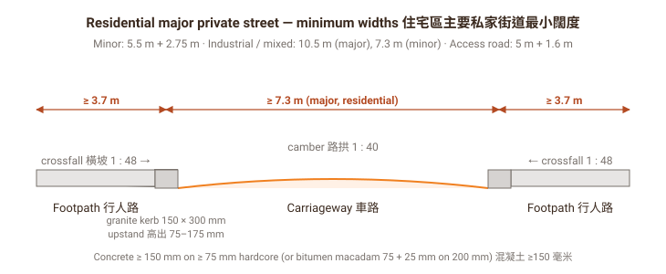
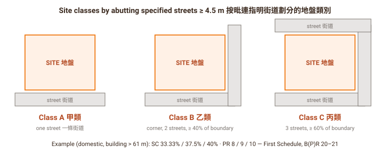
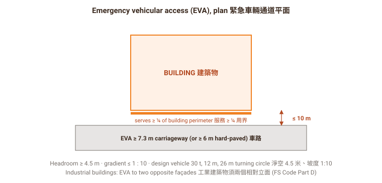

---
tags:
  - Plan submission & approval 呈交及審批
  - Excavation & ELS 挖掘
  - Minor works 小型工程
  - GFA concession 樓面面積寬免
  - Signboard 招牌
  - Occupation permit 佔用許可證
  - Drainage 排水
  - Demolition 拆卸
  - Barrier free access 無障礙
  - Site safety 地盤安全
  - Means of access 救援通道
  - GFA 總樓面面積
summary: "Timelines and workflows: plan submission to occupation permit, statutory periods and typical sequences of approvals."
keywords: workflows, 流程, timeline, 時間表, plan approval, occupation permit, statutory period
---
# Timelines & workflows <small>時間表及流程圖</small>

All the timeline, workflow and relationship diagrams on one page. Click the link under each diagram for the full entry. 本頁集合所有時間表、流程及關係圖。

!!! note "Note 注意"
    These diagrams simplify the law. Periods are the statutory or normal BD periods stated in the source; always check the linked page and the official text.

## Plan approval to occupation 由審批至佔用 {#plan-approval-to-occupation}

<figure markdown>
  { width="366" loading=lazy }
  <figcaption>Statutory periods from plan submission to occupation (BO s.14–21, B(A)R 30–33). 由呈交圖則至佔用的法定期限。 → [Full entry 詳細內容](regulations/bo-part-2-building-works.md)</figcaption>
</figure>

<figure markdown>
  { width="521" loading=lazy }
  <figcaption>Overview of the building approval process. 建築圖則批准程序概覽。 → [Full entry 詳細內容](pnap/adm-19.md)</figcaption>
</figure>

<figure markdown>
  { width="394" loading=lazy }
  <figcaption>Centralised processing: what happens by day 45 and day 60. 中央處理：第 45 及 60 天。 → [Full entry 詳細內容](pnap/adm-2.md)</figcaption>
</figure>

<figure markdown>
  { width="760" loading=lazy }
  <figcaption>Withdrawal and resubmission restarts the clock, at most twice. 撤回並重新提交最多兩次。 → [Full entry 詳細內容](pnap/adm-22.md)</figcaption>
</figure>

<figure markdown>
  { width="520" loading=lazy }
  <figcaption>Normal or fast-track consent? 一般程序還是快速處理？ → [Full entry 詳細內容](pnap/app-97.md)</figcaption>
</figure>

<figure markdown>
  { width="671" loading=lazy }
  <figcaption>Completion submissions and BD reply periods. 完工呈交及屋宇署回覆期限。 → [Full entry 詳細內容](pnap/app-13.md)</figcaption>
</figure>

<figure markdown>
  { width="615" loading=lazy }
  <figcaption>Occupation permit inspection workflow. 佔用許可證巡查流程。 → [Full entry 詳細內容](pnap/app-78.md)</figcaption>
</figure>

<figure markdown>
  { width="760" loading=lazy }
  <figcaption>B(A)R deadlines at a glance. 《建築物（管理）規例》期限一覽。 → [Full entry 詳細內容](regulations/bar-123a.md)</figcaption>
</figure>

## Site works 地盤工程 {#site-works}

<figure markdown>
  { width="381" loading=lazy }
  <figcaption>Do I need ELS plans? 是否須呈交挖掘及側向承托圖則？ → [Full entry 詳細內容](pnap/app-57.md)</figcaption>
</figure>

<figure markdown>
  { width="464" loading=lazy }
  <figcaption>Demolition workflow. 拆卸工程流程。 → [Full entry 詳細內容](pnap/app-21.md)</figcaption>
</figure>

<figure markdown>
  { width="760" loading=lazy }
  <figcaption>Concurrent approval and consent for GI in scheduled areas. 附表地區土地勘測同時處理。 → [Full entry 詳細內容](pnap/adm-16.md)</figcaption>
</figure>

<figure markdown>
  { width="320" loading=lazy }
  <figcaption>Drainage testing procedure. 排水工程測試程序。 → [Full entry 詳細內容](pnap/app-58.md)</figcaption>
</figure>

<figure markdown>
  { width="612" loading=lazy }
  <figcaption>Smart site safety conditions under s.17. 智慧工地安全條件。 → [Full entry 詳細內容](pnap/app-162.md)</figcaption>
</figure>

## Minor works and inspection 小型工程及檢驗 {#minor-works-and-inspection}

<figure markdown>
  { width="760" loading=lazy }
  <figcaption>Minor works: who does what, and when. 小型工程：負責人及時限。 → [Full entry 詳細內容](pnap/app-147.md)</figcaption>
</figure>

<figure markdown>
  { width="343" loading=lazy }
  <figcaption>MBIS / MWIS: inspection and repair timeline. 強制驗樓／驗窗時間表。 → [Full entry 詳細內容](regulations/bir-123p.md)</figcaption>
</figure>

## Who and what 人物及文件關係 {#who-and-what}

<figure markdown>
  { width="760" loading=lazy }
  <figcaption>Map of the Buildings Ordinance and its subsidiary legislation. 條例及附屬法例關係圖。 → [Full entry 詳細內容](regulations/index.md)</figcaption>
</figure>

<figure markdown>
  { width="760" loading=lazy }
  <figcaption>How the practice note series fit together. 作業備考系列關係。 → [Full entry 詳細內容](pnap/adm-1.md)</figcaption>
</figure>

<figure markdown>
  { width="653" loading=lazy }
  <figcaption>Who is responsible for what. 各方職責關係。 → [Full entry 詳細內容](pnap/app-141.md)</figcaption>
</figure>

## Regulations, codes and drawings 規例、守則及圖解 {#regulations-codes-and-drawings}

<figure markdown>
  { width="700" loading=lazy }
  <figcaption>Appeal timeline (Cap. 123L). 上訴時間表。 → [Full entry 詳細內容](regulations/bar-123l.md)</figcaption>
</figure>

<figure markdown>
  { width="700" loading=lazy }
  <figcaption>Ventilating system inspection cycle (Cap. 123J). 通風系統年檢。 → [Full entry 詳細內容](regulations/bvsr-123j.md)</figcaption>
</figure>

<figure markdown>
  { width="700" loading=lazy }
  <figcaption>Oil storage licence and inspection cycle (Cap. 123K). 貯油裝置牌照及檢驗。 → [Full entry 詳細內容](regulations/bosir-123k.md)</figcaption>
</figure>

<figure markdown>
  { width="700" loading=lazy }
  <figcaption>Signboard validation every 5 years. 招牌檢核。 → [Full entry 詳細內容](pnap/app-155.md)</figcaption>
</figure>

<figure markdown>
  { width="700" loading=lazy }
  <figcaption>GFA concessions and the 10% cap. 樓面面積寬免。 → [Full entry 詳細內容](pnap/app-151.md)</figcaption>
</figure>

<figure markdown>
  { width="700" loading=lazy }
  <figcaption>Fire safety codes timeline. 消防守則演變。 → [Full entry 詳細內容](codes/fire-safety-code-2011.md)</figcaption>
</figure>

<figure markdown>
  { width="700" loading=lazy }
  <figcaption>BFA 2008 to DMUA 2026. 無障礙設計手冊演變。 → [Full entry 詳細內容](pnap/app-41.md)</figcaption>
</figure>

<figure markdown>
  { width="700" loading=lazy }
  <figcaption>Contractor registers. 承建商名冊。 → [Full entry 詳細內容](pnap/app-96.md)</figcaption>
</figure>

<figure markdown>
  { width="700" loading=lazy }
  <figcaption>Private street cross-section (Cap. 123G). 私家街道剖面。 → [Full entry 詳細內容](regulations/bpsar-123g.md)</figcaption>
</figure>

<figure markdown>
  { width="700" loading=lazy }
  <figcaption>Site classes A / B / C. 地盤類別。 → [Full entry 詳細內容](regulations/bpr-18a-22.md)</figcaption>
</figure>

<figure markdown>
  { width="700" loading=lazy }
  <figcaption>Dead end vs two directions. 盡頭路與雙向。 → [Full entry 詳細內容](codes/fsc-part-b-means-of-escape.md)</figcaption>
</figure>

<figure markdown>
  { width="700" loading=lazy }
  <figcaption>Spandrel or projection. 窗間牆或伸建物。 → [Full entry 詳細內容](codes/fsc-part-c-fire-resisting-construction.md)</figcaption>
</figure>

<figure markdown>
  { width="700" loading=lazy }
  <figcaption>EVA plan. 緊急車輛通道。 → [Full entry 詳細內容](codes/fsc-part-d-means-of-access.md)</figcaption>
</figure>

<figure markdown>
  { width="700" loading=lazy }
  <figcaption>Covered walkway section. 有蓋行人道剖面。 → [Full entry 詳細內容](pnap/app-23.md)</figcaption>
</figure>

<figure markdown>
  { width="700" loading=lazy }
  <figcaption>ELS 45° zone. 45° 影響範圍。 → [Full entry 詳細內容](pnap/app-57.md)</figcaption>
</figure>

