# Timelines & workflows <small>時間表及流程圖</small>

All the timeline, workflow and relationship diagrams on one page. Click the link under each diagram for the full entry. 本頁集合所有時間表、流程及關係圖。

!!! note "Note 注意"
    These diagrams simplify the law. Periods are the statutory or normal BD periods stated in the source; always check the linked page and the official text.

## Plan approval to occupation 由審批至佔用

<figure markdown>
  { width="366" loading=lazy }
  <figcaption>Statutory periods from plan submission to occupation (BO s.14–21, B(A)R 30–33). 由呈交圖則至佔用的法定期限。 → [Full entry 詳細內容](regulations/bo-part-2-building-works.md)</figcaption>
</figure>

<figure markdown>
  { width="521" loading=lazy }
  <figcaption>Overview of the building approval process. 建築圖則批准程序概覽。 → [Full entry 詳細內容](pnap/adm-19.md)</figcaption>
</figure>

<figure markdown>
  { width="394" loading=lazy }
  <figcaption>Centralised processing: what happens by day 45 and day 60. 中央處理：第 45 及 60 天。 → [Full entry 詳細內容](pnap/adm-2.md)</figcaption>
</figure>

<figure markdown>
  { width="760" loading=lazy }
  <figcaption>Withdrawal and resubmission restarts the clock, at most twice. 撤回並重新提交最多兩次。 → [Full entry 詳細內容](pnap/adm-22.md)</figcaption>
</figure>

<figure markdown>
  { width="520" loading=lazy }
  <figcaption>Normal or fast-track consent? 一般程序還是快速處理？ → [Full entry 詳細內容](pnap/app-97.md)</figcaption>
</figure>

<figure markdown>
  { width="671" loading=lazy }
  <figcaption>Completion submissions and BD reply periods. 完工呈交及屋宇署回覆期限。 → [Full entry 詳細內容](pnap/app-13.md)</figcaption>
</figure>

<figure markdown>
  { width="615" loading=lazy }
  <figcaption>Occupation permit inspection workflow. 佔用許可證巡查流程。 → [Full entry 詳細內容](pnap/app-78.md)</figcaption>
</figure>

<figure markdown>
  { width="760" loading=lazy }
  <figcaption>B(A)R deadlines at a glance. 《建築物（管理）規例》期限一覽。 → [Full entry 詳細內容](regulations/bar-123a.md)</figcaption>
</figure>

## Site works 地盤工程

<figure markdown>
  { width="381" loading=lazy }
  <figcaption>Do I need ELS plans? 是否須呈交挖掘及側向承托圖則？ → [Full entry 詳細內容](pnap/app-57.md)</figcaption>
</figure>

<figure markdown>
  { width="464" loading=lazy }
  <figcaption>Demolition workflow. 拆卸工程流程。 → [Full entry 詳細內容](pnap/app-21.md)</figcaption>
</figure>

<figure markdown>
  { width="760" loading=lazy }
  <figcaption>Concurrent approval and consent for GI in scheduled areas. 附表地區土地勘測同時處理。 → [Full entry 詳細內容](pnap/adm-16.md)</figcaption>
</figure>

<figure markdown>
  { width="320" loading=lazy }
  <figcaption>Drainage testing procedure. 排水工程測試程序。 → [Full entry 詳細內容](pnap/app-58.md)</figcaption>
</figure>

<figure markdown>
  { width="612" loading=lazy }
  <figcaption>Smart site safety conditions under s.17. 智慧工地安全條件。 → [Full entry 詳細內容](pnap/app-162.md)</figcaption>
</figure>

## Minor works and inspection 小型工程及檢驗

<figure markdown>
  { width="760" loading=lazy }
  <figcaption>Minor works: who does what, and when. 小型工程：負責人及時限。 → [Full entry 詳細內容](pnap/app-147.md)</figcaption>
</figure>

<figure markdown>
  { width="343" loading=lazy }
  <figcaption>MBIS / MWIS: inspection and repair timeline. 強制驗樓／驗窗時間表。 → [Full entry 詳細內容](regulations/bir-123p.md)</figcaption>
</figure>

## Who and what 人物及文件關係

<figure markdown>
  { width="760" loading=lazy }
  <figcaption>Map of the Buildings Ordinance and its subsidiary legislation. 條例及附屬法例關係圖。 → [Full entry 詳細內容](regulations/index.md)</figcaption>
</figure>

<figure markdown>
  { width="760" loading=lazy }
  <figcaption>How the practice note series fit together. 作業備考系列關係。 → [Full entry 詳細內容](pnap/adm-1.md)</figcaption>
</figure>

<figure markdown>
  { width="653" loading=lazy }
  <figcaption>Who is responsible for what. 各方職責關係。 → [Full entry 詳細內容](pnap/app-141.md)</figcaption>
</figure>
